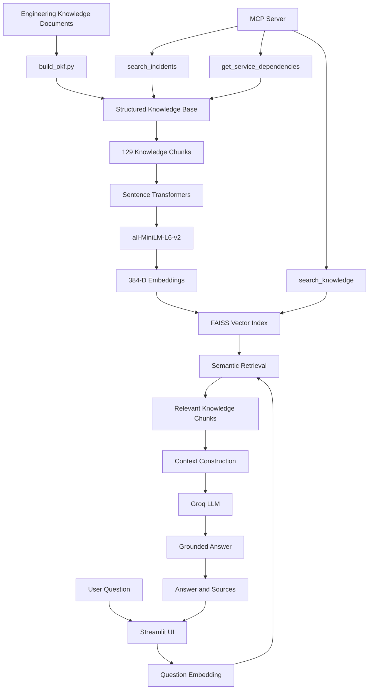
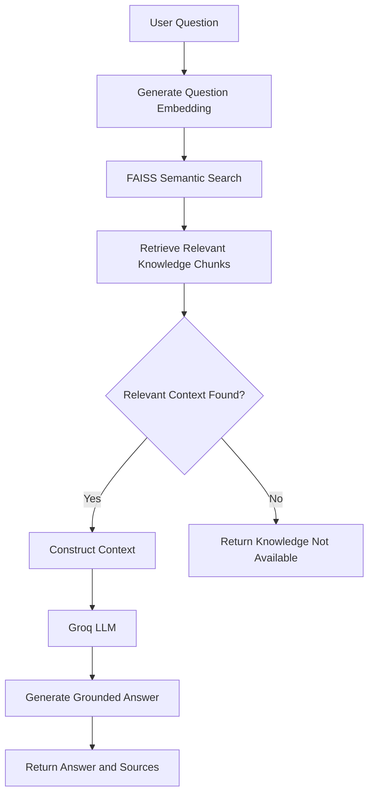
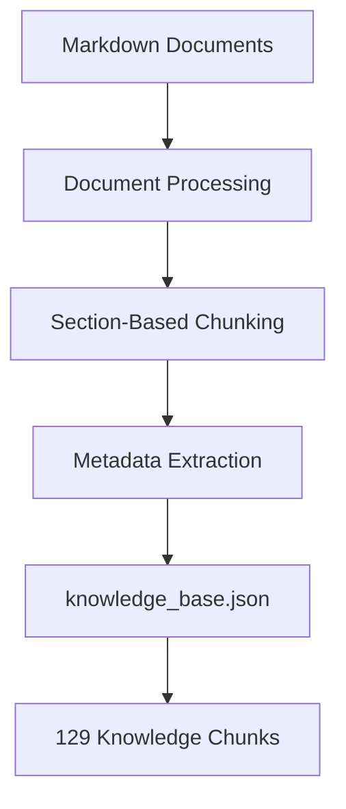

# 🧠 OpsMind — AI-Powered Internal Engineering Knowledge Assistant

OpsMind is an AI-powered internal engineering knowledge assistant designed to help engineering teams investigate operational issues using company knowledge, incident records, service documentation, architecture documents, runbooks, and policies.

The project combines **OKF-based knowledge organization, semantic search, FAISS vector retrieval, Retrieval-Augmented Generation (RAG), Groq LLM, Streamlit, and Model Context Protocol (MCP)** into a practical engineering support system.

---

## 🚀 Project Overview

In engineering environments, operational knowledge is often distributed across incident reports, service documentation, architecture documents, runbooks, and company policies.

Finding the correct information manually can take time.

OpsMind provides a centralized AI-powered interface where engineers can ask questions such as:

- Why are orders failing?
- What should I do when the Payment API returns a 500 error?
- How do I troubleshoot an authentication failure?
- What services does the Order Service depend on?
- Which incidents are related to order failures?
- What information is available about a particular service?

OpsMind retrieves relevant internal knowledge and uses an LLM to generate answers grounded in the retrieved context.

---

## ✨ Key Features

- Internal engineering knowledge base
- OKF-style structured knowledge organization
- Document processing and section-based chunking
- Semantic search using sentence embeddings
- FAISS vector similarity search
- RAG-based question answering
- Groq LLM integration
- Source-aware answers
- Relevance filtering for unknown questions
- Streamlit web interface
- MCP server with reusable engineering tools
- Incident and service dependency search

---

## 🏗️ System Architecture



### Architecture Components

| Component | Responsibility |
|---|---|
| Knowledge Documents | Store engineering services, incidents, runbooks, architecture, and policies |
| `build_okf.py` | Process documentation into structured knowledge |
| Sentence Transformers | Convert text into numerical embeddings |
| FAISS | Retrieve semantically similar knowledge chunks |
| RAG Pipeline | Build context from retrieved documents |
| Groq LLM | Generate context-grounded answers |
| Streamlit | Provide the user interface |
| MCP Server | Expose reusable engineering knowledge tools |

---

## 🔄 RAG Workflow

OpsMind follows a Retrieval-Augmented Generation workflow to answer engineering questions using relevant internal documentation.



The LLM receives retrieved engineering knowledge as context and is instructed to answer using that context rather than inventing information.

---

## 📚 Knowledge Base

The project organizes engineering knowledge into different categories.

### Services

Examples include:

- Authentication Service
- Order Service
- Inventory Service
- Payment API
- Notification Service
- Search Service

### Incidents

Examples include:

- Order Service HTTP 500 errors
- Authentication failures
- Payment timeouts
- Inventory synchronization issues
- Deployment failures
- Database timeout incidents

### Runbooks

Examples include:

- Authentication failure troubleshooting
- Database timeout troubleshooting
- Inventory synchronization failure
- Order API 500 troubleshooting
- Payment API 500 troubleshooting
- Service degradation handling

### Architecture

Examples include:

- Database architecture
- Service dependencies
- System architecture

### Policies

Examples include:

- Deployment policy
- Escalation policy
- Incident severity policy

---

## 🧩 OKF Knowledge Processing

The project uses `build_okf.py` to process engineering documentation into structured knowledge chunks.

### Knowledge Processing Pipeline



The current knowledge base contains **129 knowledge chunks**.

These chunks organize engineering information into smaller units that can be searched and retrieved efficiently.

---

## 🔢 Embeddings

OpsMind uses the `all-MiniLM-L6-v2` sentence-transformer model to convert text into numerical vector representations.

**Embedding configuration:**

- Model: `all-MiniLM-L6-v2`
- Embedding dimension: `384`

Embeddings allow the system to compare the semantic meaning of a user's question with stored engineering knowledge.

For example, a question about order failures may retrieve information about the Order Service, related incidents, and dependent services, even when the wording differs from the original documents.

---

## 🔍 FAISS Vector Search

OpsMind uses **FAISS** for vector similarity search.

The generated vector index is:

```text
knowledge.index
```

FAISS searches for knowledge chunks that are semantically related to the user's question.

### Example

```text
Question:
Why are orders failing?
        |
        v
Question Embedding
        |
        v
FAISS Semantic Search
        |
        v
Relevant Knowledge
  - Order Service
  - Order Service incidents
  - Inventory Service
  - Deployment incidents
```

The retrieved results are passed to the RAG pipeline for answer generation.

---

## 🤖 RAG Answer Generation

After retrieving relevant knowledge, OpsMind builds a context containing the retrieved documents and sends it to the Groq LLM.

Example system instruction:

```text
Answer the user's question using only the provided context.

If the answer is not available in the context,
say that the information is not available
in the OpsMind knowledge base.

Do not invent facts.
```

This approach helps keep answers grounded in internal engineering documentation.

Source-aware responses can help engineers trace information back to the relevant knowledge records when source metadata is available.

**Note:** RAG reduces the risk of unsupported answers but does not guarantee perfect accuracy. Engineers should verify critical operational instructions against the original documentation.

---

## ⚡ Groq LLM Integration

OpsMind uses Groq for LLM-based answer generation.

**Configured model:**

```text
openai/gpt-oss-20b
```

The API key is stored in a `.env` file rather than being hardcoded in the source code.

Example environment variable:

```env
GROQ_API_KEY=your_api_key
```

### Security Practices

- Keep API keys out of source code.
- Never commit your real `.env` file to GitHub.
- Store secrets in environment variables.
- Configure production secrets through the deployment platform when applicable.

---

## 🔌 MCP Integration

OpsMind provides an MCP server that exposes engineering knowledge through reusable tools.

The MCP server provides three tools.

### 1. Search Knowledge

```python
search_knowledge(query)
```

Searches the OpsMind knowledge base for relevant engineering information.

**Example use case:** Find documentation related to a Payment API error.

### 2. Search Incidents

```python
search_incidents(query)
```

Searches incident records for operational problems and related historical incidents.

**Example use case:** Find incidents related to order-processing failures.

### 3. Get Service Dependencies

```python
get_service_dependencies(service)
```

Returns available dependency information for a specified service.

**Example dependency relationship:**

```text
Order Service
     |
     +---- Payment API
     |
     +---- Inventory Service
```

These tools allow MCP-compatible clients and agents to interact with the OpsMind engineering knowledge system through structured tool calls.

---

## 🖥️ Streamlit Interface

OpsMind provides a Streamlit interface where users can submit engineering questions and review generated answers.

### Example Question

```text
Why are orders failing?
```

### Typical Request Flow

```text
User Question
      |
      v
Streamlit Interface
      |
      v
Question Embedding
      |
      v
FAISS Semantic Retrieval
      |
      v
Relevant Knowledge Chunks
      |
      v
Groq LLM
      |
      v
Answer and Sources
```

The interface provides a practical way to explore engineering documentation without manually searching multiple files.

---

## 🛠️ Technology Stack

| Technology | Purpose |
|---|---|
| Python | Core application development |
| OKF-style knowledge organization | Structured engineering knowledge |
| Markdown | Engineering source documents |
| JSON | Structured knowledge storage |
| Sentence Transformers | Text embeddings |
| `all-MiniLM-L6-v2` | Embedding model |
| FAISS | Vector similarity search |
| RAG | Context-grounded question answering |
| Groq | LLM inference |
| Streamlit | Web interface |
| MCP | Reusable engineering knowledge tools |
| Git and GitHub | Version control and project hosting |

---

## 📁 Project Structure

The following is an illustrative structure. Adjust filenames and directories to match the actual repository.

```text
OpsMind/
├── Knowledge/
│   ├── Services/
│   ├── Incidents/
│   ├── Runbooks/
│   ├── Architecture/
│   └── Policies/
├── build_okf.py
├── knowledge_base.json
├── knowledge.index
├── rag/
├── mcp_server/
├── app.py
├── .env
├── requirements.txt
└── README.md
```

### Main Components

- `build_okf.py` — Processes engineering documentation into structured knowledge.
- `knowledge_base.json` — Stores the processed knowledge records, if generated under this filename.
- `knowledge.index` — Stores the FAISS vector index, if generated under this filename.
- `rag/` — Represents the retrieval and answer-generation components, if organized this way.
- `mcp_server/` — Represents the MCP server components, if organized this way.
- `app.py` — Represents the Streamlit entry point, if this is the actual filename.
- `requirements.txt` — Lists the project's Python dependencies.

---

## 💡 Example Use Cases

OpsMind can support engineering teams with tasks such as:

- Investigating order-processing failures
- Troubleshooting HTTP 500 errors
- Finding relevant historical incidents
- Understanding service dependencies
- Locating operational runbooks
- Searching internal engineering documentation
- Supporting incident investigation and triage

---

## 🔒 Security and Reliability

- Store API keys in environment variables.
- Exclude `.env` and secret files from version control.
- Ground generated answers in retrieved source documents.
- Use a fallback when relevant information is unavailable.
- Verify operational instructions against the original runbooks before applying changes.
- Avoid exposing confidential engineering documentation to unauthorized users.

---

## 🚀 Future Improvements

- Add more engineering documents and incident records.
- Improve retrieval ranking and relevance evaluation.
- Add automated tests for the RAG pipeline.
- Improve source citations and retrieval transparency.
- Add observability and retrieval-performance metrics.
- Integrate with additional MCP-compatible engineering agents.
- Add authentication and access control for team deployments.
- Evaluate answer quality using a representative set of engineering questions.

---

## 👨‍💻 Author

**Divakar Putta**

AI/ML Professional | Generative AI | RAG | AI Agents | Python | LangGraph

GitHub: [diva-hug](https://github.com/diva-hug)

---

## ⭐ Project Goal

OpsMind demonstrates how structured engineering knowledge, semantic retrieval, RAG, LLMs, and MCP tools can work together to help engineering teams find relevant operational information more efficiently.
